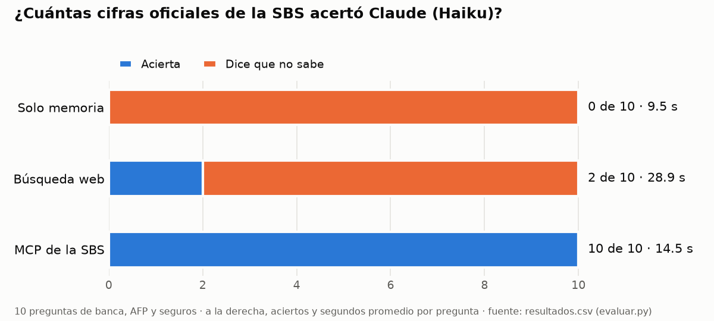

# Informe: ¿Claude acierta las cifras de la SBS sin su MCP?

**Respuesta corta:** no. Con Haiku, el MCP acertó **10 de 10** cifras oficiales; solo con su memoria, **0 de 10**, y
con búsqueda web, **2 de 10**. En ningún modo inventó una cifra: cuando no tenía el dato, respondió que no lo sabía.

## Cómo se midió

- **Preguntas:** 10 en [`preguntas.csv`](preguntas.csv), repartidas en banca (3), AFP (4) y seguros (3). Cada una
  trae la cifra oficial, la tolerancia de redondeo, el boletín, el periodo y la celda del Excel de la SBS de donde
  sale. Las verdades se leyeron directo de las celdas, sin pasar por el servidor.
- **Modos:** `uv run evaluar.py --modos memoria web mcp --paralelo 2` el 28 de octubre de 2026, con Haiku.
  - `memoria`: sin herramientas.
  - `web`: solo WebSearch y WebFetch.
  - `mcp`: solo las herramientas de este servidor.
- **Instrucción:** cada pregunta pide un número y permite responder `null` si no hay certeza.

## Resultados

| Modo | Acierta | No sabe | Se equivoca | Segundos promedio |
|---|---|---|---|---|
| Solo memoria | 0 | 10 | 0 | 9.5 |
| Búsqueda web | 2 | 8 | 0 | 28.9 |
| MCP de la SBS | **10** | 0 | 0 | 14.5 |

El detalle por pregunta, con la fuente que dio Claude en cada caso, está en [`resultados.csv`](resultados.csv).

## Qué falló y por qué

- **Memoria (0/10).** Las preguntas son de agosto y setiembre de 2026, después de lo que el modelo aprendió. Las 10
  veces respondió `null` y explicó que no tenía acceso a datos de la SBS. Es el comportamiento correcto, y en parte
  se debe a que la instrucción le permitía no responder.
- **Búsqueda web (2/10).** Solo acertó las dos cifras que repiten blogs y medios: la comisión de Integra (0.78 %,
  según sueldojusto.pe) y la prima de seguro de las AFP (1.37 %, según misha.pe y buk.pe).
  - Para el resto intentó ir a la fuente: abrió páginas de `www.sbs.gob.pe/app/stats/...` (FP-1359, FP-1360 y la de
    morosidad). La SBS no le devolvió datos, porque esa web responde a los programas con un desafío anti-robots.
  - En la rentabilidad del fondo 2 de Prima, un resultado de búsqueda citaba 19.212 %, la cifra correcta. Claude no
    la usó porque no pudo confirmarla en la fuente.
- **MCP (10/10).** Cada respuesta salió de una herramienta y citó el boletín, el periodo y la URL del Excel. Por
  ejemplo: «SBS, Indicadores Financieros por Empresa Bancaria (B-2401), periodo 2026-08… entidad B. BBVA Perú». El
  MCP lee `intranet2.sbs.gob.pe`, el servidor de archivos de la propia SBS, que entrega los Excel sin desafío.
  Además respondió dos veces más rápido que la web.

## Cifras comprobadas a mano en la SBS

Cada cifra se comprueba abriendo el Excel de la SBS en el navegador y buscando la celda indicada.

| Cifra del MCP | Boletín y celda | Enlace | Comprobada a mano |
|---|---|---|---|
| Morosidad del BBVA Perú, agosto de 2026: **2.72 %** | B-2401, celda B14 | [B-2401-ag2026.XLS](https://intranet2.sbs.gob.pe/estadistica/financiera/2026/Agosto/B-2401-ag2026.XLS) | ☐ pendiente |
| Comisión sobre saldo de AFP Integra, setiembre de 2026: **0.78 %** | FP-1232, celda B9 | [FP-1232-se2026.XLS](https://intranet2.sbs.gob.pe/estadistica/financiera/2026/Setiembre/FP-1232-se2026.XLS) | ☐ pendiente |

> **Pendiente del autor:** abrir los dos enlaces, confirmar cada celda y cambiar «☐ pendiente» por «☑» con la fecha.

## Experimento extra: contra la búsqueda web

El modo `web` es el experimento extra. Muestra que la diferencia no es solo de memoria: **la información de la SBS
existe pero no está al alcance de un buscador**. La web de estadísticas bloquea a los programas, y los medios solo
repiten un puñado de cifras (comisiones de AFP, sí; morosidad de una caja o ROE de una aseguradora, no).

## Conclusión

Vale la pena construir un MCP cuando la fuente oficial publica datos que los buscadores no indexan o no pueden leer,
como los Excel mensuales de la SBS. Si la cifra aparece en noticias (la prima de seguro de las AFP), la búsqueda web
alcanza, aunque tarda el doble. Para preguntas por entidad y periodo, el MCP pasa de 0 o 2 aciertos a 10, y además
deja la URL exacta del archivo para que cualquiera lo verifique. Su límite también quedó claro: lo que la SBS solo
publica tras el desafío anti-robots, como Retasas, sigue fuera de alcance.
